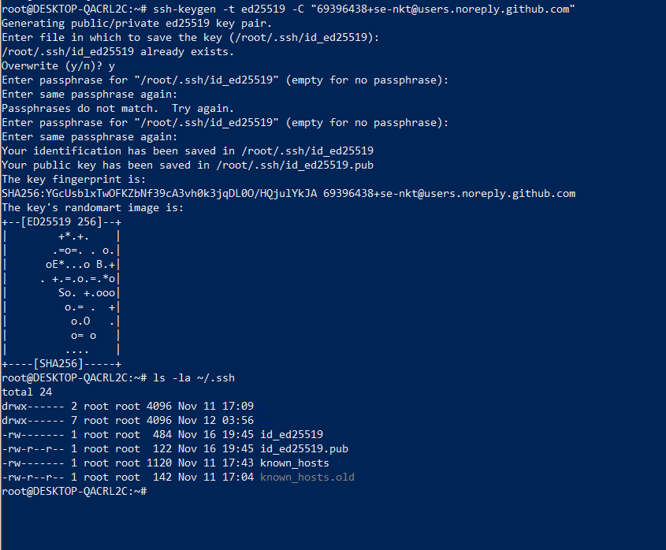
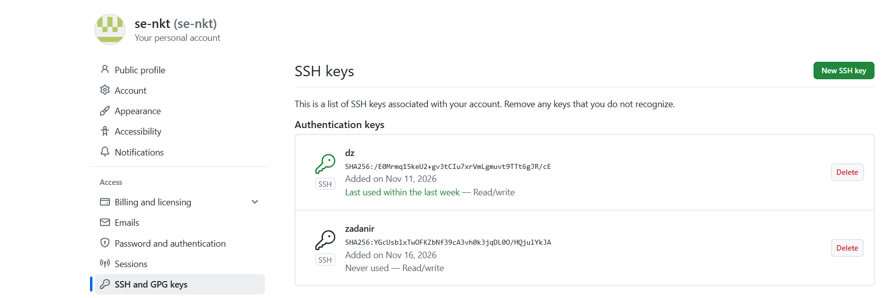
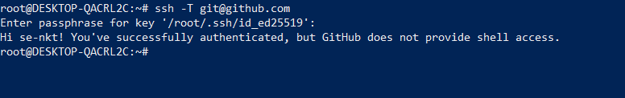
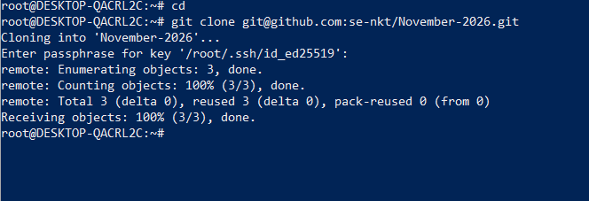
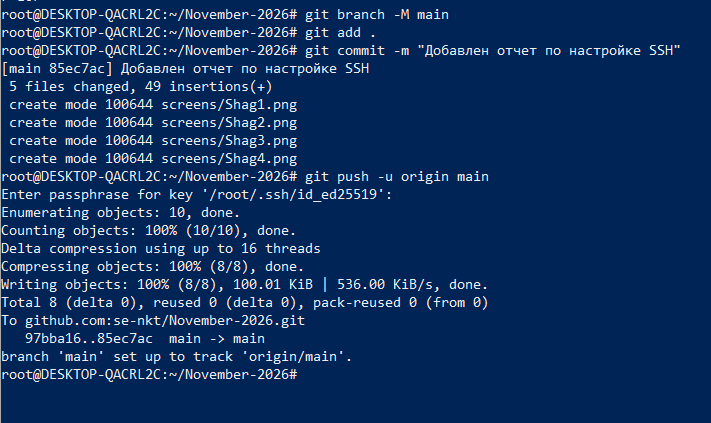

# Отчет по настройке SSH-подключения к GitHub

## Шаг 1. Проверка SSH-клиента и генерация ключей
Проверил версию установленного OpenSSH-клиента и сгенерировал пару ключей по алгоритму `ed25519` с защитной кодовой фразой (`passphrase`).

```bash
ssh -V
ssh-keygen -t ed25519 -C "69396438+se-nkt@users.noreply.github.com"
ls -la ~/.ssh
```



---

## Шаг 2. Добавление публичного ключа в GitHub
Скопировал содержимое публичного ключа (`id_ed25519.pub`) и добавил его в настройки аккаунта GitHub в разделе **Settings → SSH and GPG keys**.

```bash
cat ~/.ssh/id_ed25519.pub
```



---

## Шаг 3. Проверка SSH-подключения
Выполнил тестовое подключение к серверу GitHub и подтвердил успешную аутентификацию.

```bash
ssh -T git@github.com
```



---

## Шаг 4. Клонирование, коммит и отправка по SSH
Склонировал репозиторий по SSH-ссылке, добавил скриншоты, оформил отчет и отправил изменения в удаленный репозиторий без ввода логина и пароля от аккаунта.

```bash
git clone git@github.com:se-nkt/ssh-setup-practice.git
git add .
git commit -m "Добавлен отчет по настройке SSH"
git push -u origin main
```



